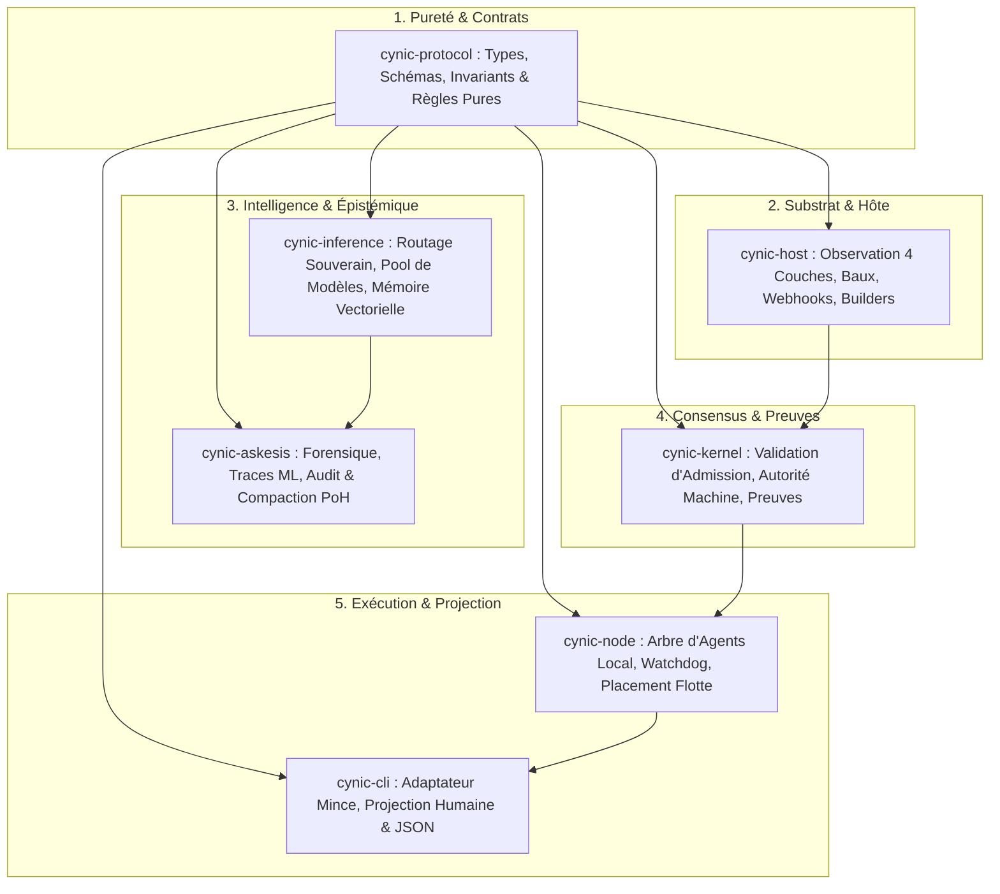

# Architecture Système Souveraine — SoC, Causalité & Convergence Agentique (CYNIC)

STATUS: Spécification canonique d'architecture système et de séparation des responsabilités (SoC).
AUTORITÉ: Transpose `contracts/foundation.json` (§71-75, §49, §481, §489) et `contracts/framework.json` en un modèle d'ingénierie complet et actionnable.

---

## 1. Principes Fondateurs & Rôle de l'Humain Souverain

CYNIC est la **membrane souveraine pour la futarchie à une personne (One-Person Futarchy)**. 
L'opérateur humain n'est pas un spectateur du système : il en est **l'autorité constitutionnelle et la source de valeur ultime**.

### 1.1 L'IA comme Extension Cognitive (Vitesse & Précision sans Abandon d'Autorité)
- **Le LLM amplifie la vélocité cognitive** : Il explore, synthétise, formule des hypothèses, génère des tests et rédige du code sous contrainte formelle.
- **Le LLM n'est JAMAIS l'autorité souveraine** : Aucune décision de mutation de runtime, de changement de politique de flotte ou de publication d'artifact ne peut être décrétée par un modèle seul sans preuve vérifiée ou consentement humain explicite.
- **Réfutation du modèle « Prompt-as-Law »** : L'état du système vit dans les contrats Rust typés, les registres immuables et les preuves de lecture arrière (Read-Back), jamais dans la mémoire volatile d'un chat LLM.

### 1.2 Le « POURQUOI » Intégré comme Loi de Runtime (Causalité Explicite)
Tout agent et tout développeur doit pouvoir répondre aux **4 Questions Canoniques** avant toute modification :

```text
┌─────────────────────────────────────────────────────────────────────────────┐
│ 1. OÙ ?       │ Crate, module, port, adaptateur et registre source.         │
│ 2. QUOI ?     │ État désiré vs état observé réel + inconnus résiduels.      │
│ 3. COMMENT ?  │ Action bornée, argv exact, worktree isolée et rollback.     │
│ 4. POURQUOI ? │ Contrat défendu, invariant protégé, risque évité et preuve. │
└─────────────────────────────────────────────────────────────────────────────┘
```

---

## 2. Séparation des Responsabilités (SoC) par Crate

Chaque crate possède **une responsabilité primaire exclusive** (`contracts/framework.json` §481 `one_boundary_one_reason`). Aucun orchestrateur monolithique centralisé n'est toléré (§489).



### Grille d'Ownership Canonique

| Crate | Responsabilité Primaire (OWNS) | Délégations (DELEGATES) | Interdictions Strictes (FORBIDDEN) |
|---|---|---|---|
| **`cynic-protocol`** | Schémas JSON, types d'enveloppes, invariants purs, baux, matrices de capacité. | Exécution I/O $\to$ `cynic-host`. | **Toute I/O réseau, tout appel système, toute mutation d'état.** |
| **`cynic-host`** | Substrat hôte 4 couches (Disk/Mem/CPU/Net/PSI), gestion des worktrees Git, adaptateurs SSH/Process. | Décision d'inférence $\to$ `cynic-inference`. | **Posséder la logique d'inférence ou le registre de coordination.** |
| **`cynic-inference`** | Inférence locale souveraine (`llama-server`), mémoire vectorielle, matrice de benchmark. | Stockage durable $\to$ `cynic-askesis`. | **Exfiltrer des données `Private`/`Sensitive` vers des backends cloud.** |
| **`cynic-askesis`** | Forensique de session, compaction PoH SHA-512, extraction de cristaux, traces d'entraînement. | Calcul d'embeddings $\to$ `cynic-inference`. | **Devenir une autorité bloquante pour le boot du runtime.** |
| **`cynic-kernel`** | Admissions cryptographiques (`workload_grant`), consensus, attribution d'identité machine. | Exécution de compilation $\to$ build runner. | **Compiler du code sans grant machine signé.** |
| **`cynic-cli`** | Clap parsing, injection de contexte, projection JSON / Humaine. | Toute logique métier $\to$ crates dédiés. | **Définir des tables de politique ou posséder des schémas d'état.** |

---

## 3. La Trinité Physique-Économique : Location, Comptabilité, Énergie

### 3.1 La Location (Le Bail comme Primitif Spatio-Temporel)
- **Ressources bornées** : Rien n'est possédé définitivement ; tout est alloué par un **Bail temporaire (`ClaimLease`)**.
- **Scope Hiérarchique** : $\text{Fleet} \to \text{Node} \to \text{Crate} \to \text{Module} \to \text{File}$.
- **Fencing Token (`fencing_token: u64`)** : Tout accès concurrent avec un jeton obsolète est immédiatement rejeté pour empêcher tout *split-brain*.

### 3.2 La Comptabilité en Partie Double
- **Principe de Conservation** : Aucun agent ne peut consommer de tokens, de RAM ou de temps machine sans contrepartie prouvée.
$$\text{DÉBIT (Coût : Tokens LLM + CPU Jiffies + Wall-Time)} \equiv \text{CRÉDIT (Valeur : Tests verts + Preuves de Build + Cristaux)}$$
- **Monotonie Budgétaire** : L'autorité et les budgets d'un sous-agent ne peuvent que décroître strictement par rapport à son parent.

### 3.3 L'Énergie & la Thermodynamique (Métabolisme)
- **États Métaboliques** :
  - `HighPerformance` (CPU < 40%, RAM < 60%, PSI nul) $\to$ Tâches lourdes et apprentissage admis.
  - `Standard` (Charge nominale) $\to$ Inférence et réconciliations courantes.
  - `Survival` (CPU > 85% ou RAM > 90%, PSI actif) $\to$ **Refus strict d'admission de nouvelles tâches**, isolation du nœud.
- **ROI d'une Tâche** :
$$\text{ROI} = \frac{\Delta \text{Valeur de Preuve} + \text{Gain de Couverture} - \text{Pénalités (Dettes / Stubs)}}{\text{Énergie Dissipée (Tokens} \times \text{Watts-heures)}}$$

---

## 4. La Méthode Scientifique & Les Boucles Circulaires (Autopoïèse)

L'organisme CYNIC ne procède pas par accumulation linéaire aveugle, mais par **boucles d'expérimentation réfutables** :

```text
       ┌──────────────► 1. OBSERVATION (Substrat 4 Couches & PSI) ◄─────────────┐
       │                                                                        │
       │                                                                        │
5. PEER REVIEW & VERDICT                                               2. HYPOTHÈSE CAUSALE
 (Jury Dogs : HOWL/BARK)                                                (Compass & Invariants)
       ▲                                                                        │
       │                                                                        │
       │                                                                        ▼
4. RÉFUTATION / ANALYSE ◄──────── 3. EXPÉRIMENTATION ISOLÉE ──────────► 2b. SIMULATION
  (make check & PoH SHA-512)         (Worktree éphémère jetable)         (Validation statique)
```

### 4.1 Le Moteur Forensique de Session
Quand une session agentique échoue :
1. **Extraction de l'anomalie** : L'erreur est catégorisée (`UnmodelledContract`, `PremiseHallucination`, `ScopeDrift`, `ToolchainICE`).
2. **Synthèse d'un Cristal (`ForensicCrystal`)** : La cause racine est cristallisée sous forme d'un invariant formel et d'un test de non-régression.
3. **Amorçage (*Priming*)** : Le cristal est injecté dans le contexte initial des sessions futures opérant sur le même scope.

### 4.2 Le Garbage Collector des Motifs (`Pattern GC`)
- **Élagage sans amnésie** : Le `Pattern GC` analyse les motifs cognitifs via des fenêtres glissantes (`Recurring`, `Emerging`, `Fading`).
- **Continuité PoH** : Les anciens logs sont compactés en archives froides ; le premier événement chaud conserve son `prev_hash` pointant sur l'ancre du segment compacté. La chaîne causale n'est **jamais brisée**.

---

## 5. L'Architecture des 5 Queues Universelles

Pour éviter tout couplage bloquant entre microservices, chaque flux asynchrone utilise le contrat universel `SovereignQueue<T>` (idempotence, TTL, baux fencés, dead-letter) :

```text
┌──────────────────┬──────────────────────────┬──────────────────────────┬──────────────────┐
│ File d'Attente   │ Schéma d'Enveloppe       │ Contenu Transporté       │ Consommateur     │
├──────────────────┼──────────────────────────┼──────────────────────────┼──────────────────┤
│ 1. `TaskQueue`   │ cynic.agent_workload.v1  │ Tâches & Budgets         │ Worktree Agent   │
│ 2. `MergeQueue`  │ cynic.patch_bundle.v1    │ Patches Validés          │ Gatekeeper Main  │
│ 3. `InferQueue`  │ cynic.inference_intent.v1│ Prompts & Classification │ llama-server Pool│
│ 4. `EvidenceQueue│ cynic.evidence.v1        │ Observations 4 Couches   │ Journal PoH      │
│ 5. `ForensicQueue│ cynic.forensic_event.v1  │ Anomalies & Traces       │ Moteur Askesis   │
└──────────────────┴──────────────────────────┴──────────────────────────┴──────────────────┘
```

---

## 6. Règle Constitutionnelle de Finition des Verticales

> **RÈGLE DE CLÔTURE ABSOLUE (Anti-Chantier Inachevé) :**
> Aucune nouvelle brique ou nouveau microservice ne peut être entamé tant que la verticale en cours n'a pas validé la chaîne complète :
> $$\text{Contrat Protocol} \longrightarrow \text{Adaptateur Host} \longrightarrow \text{Porte make check} \longrightarrow \text{Tests Unitaires Verts} \longrightarrow \text{Surface CLI}$$

Tout concept théorique sans test de lecture arrière ou sans projection CLI fonctionnelle est interdit d'intégration sur `main`.
