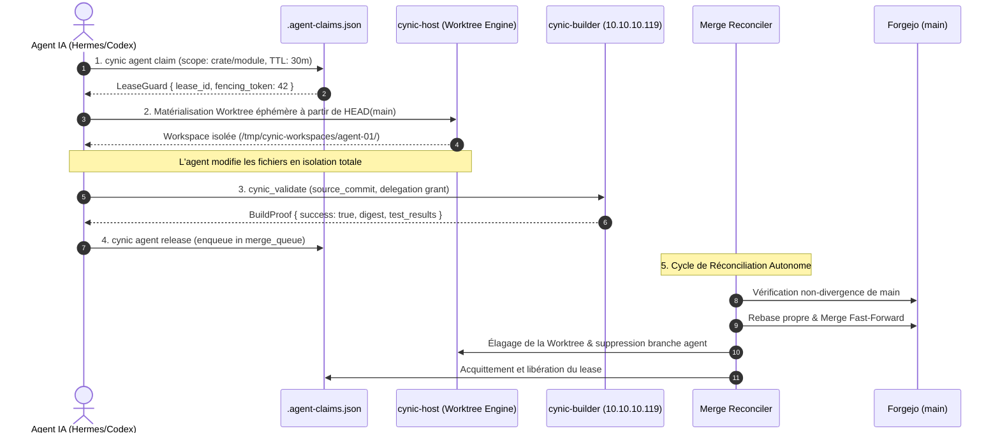
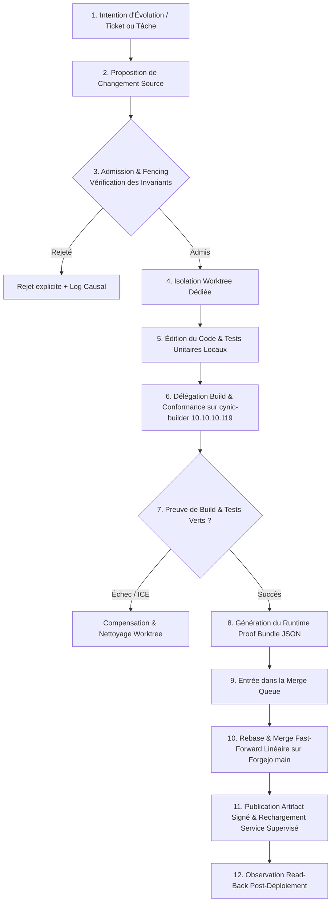

# Cartographie Système & Concurrence Agentique — CYNIC

STATUS: Spécification canonique et cartographie opérationnelle de l'interaction LLM/Agent, de la concurrence Git multi-agents et de l'auto-reproduction logicielle.
AUTORITÉ: Transpose `contracts/foundation.json` (§481, §489), `contracts/framework.json` et `infra/SOVEREIGN_SYSTEM_DESIGN.md` en un modèle d'ingénierie exécutable.

---

## 1. La Réalité Opérationnelle des LLMs & Agents

Pour qu'un système autopoïétique fonctionne de manière stable, il doit être conçu en intégrant les **propriétés réelles et les limites intrinsèques des LLMs** plutôt qu'en idéalisant leur comportement.

```
┌─────────────────────────────────────────────────────────────────────────────┐
│                      PROPRIÉTÉS FRACTALES DES AGENTS LLM                    │
├────────────────────────────────┬────────────────────────────────────────────┤
│ 1. Mémoire Volatile            │ Disparaît à chaque fin de session / crash. │
│ 2. Fenêtre de Contexte Bornée  │ Sature vite ; risque d'hallucination.      │
│ 3. Instabilité de Compilation  │ Tentatives de builds locaux saturant la VM.│
│ 4. Tendance au Désordre Git    │ Branches orphelines, conflits d'édition.   │
│ 5. Nature Probabiliste         │ Nécessite des garde-fous déterministes.    │
└────────────────────────────────┴────────────────────────────────────────────┘
```

### 1.1 Invariant Fondamental : L'État Réside dans le Substrat, Jamais dans le Modèle
* **Le modèle LLM ne possède AUCUN état d'autorité** : Ni sa mémoire vive, ni son prompt système, ni son historique de chat ne constituent la vérité du système.
* **La vérité vit dans les 4 piliers immuables** :
  1. Les **registres déclarés** (`infra/registry.json`, `infra/surface-registry.json`).
  2. Les **contrats formels** (`contracts/foundation.json`, `contracts/framework.json`).
  3. L'**arbre Git canonique** (Forgejo SSOT).
  4. Les **preuves de lecture arrière (Read-Back Evidence)** générées par les observateurs de bas niveau.

---

## 2. Les Deux Modes d'Interaction : HITL vs Autonome

CYNIC articule la collaboration Homme-Machine selon deux régimes complémentaires :

```mermaid
graph TD
    subgraph RÉGIME 1 : HITL (Human-In-The-Loop)
        H[Opérateur Humain Souverain] -->|Intention & Arbitrage Stratégique| A1[Agent Interactif / Pair Programming]
        A1 -->|Propositions, Diagnostics & Preuves| H
        H -->|Injection Secrets Temporaires HumanAdmin| P1[Actions Bornées & Validées]
    end

    subgraph RÉGIME 2 : AUTONOME (Node Scheduler)
        SCHED[cynic-node Scheduler] -->|Dispatch Workload Envelope| A2[Agent Autonome / Hermes / Talaria]
        A2 -->|Prise de Bail Fencé| LEASE[.agent-claims.json]
        A2 -->|Isolation Worktree Dédiée| WT[/tmp/cynic-workspaces/...]
        A2 -->|Délégation Compilation Distante| BLD[cynic-builder 10.10.10.119]
        BLD -->|Preuve Read-Back JSON| COMP[Completion Envelope]
        COMP -->|Merge Fast-Forward Autonome| MAIN[Forgejo main]
    end
```

### 2.1 Mode HITL (Souveraineté Directe & Guidage Épistémique)
* L'humain est le garant du sens, du ROI, des priorités et de l'architecture.
* L'agent interactif explore, cartographie, écrit du code chirurgical et présente des preuves tangibles (diffs, tests unitaires, rapports JSON).
* L'humain arbitre les bifurcations où plusieurs choix techniques ont des compromis fondamentaux.

### 2.2 Mode Autonome (Convergence Continue par Scheduler)
* Aucun humain n'intervient pour merger des branches, gérer des conflits Git ou taper des commandes de maintenance.
* L'agent autonome reçoit une enveloppe formelle (`AgentWorkloadEnvelope`) avec :
  - Un périmètre strict de mutation (ex: `crates/cynic-host/src/lifecycle/`).
  - Un budget strict et monotone (`AgentBudget` : tokens, actions, temps, CPU).
  - Un bail de coordination avec fencing token immuable.

---

## 3. Concurrence Git Multi-Agents : Le Modèle Zéro-Friction

Le modèle traditionnel des plateformes SaaS (branche Git manuelle $\rightarrow$ Pull Request $\rightarrow$ Revue manuelle $\rightarrow$ Merge conflictuel) est **inadapté à une flotte d'agents IA autonomes**. Il produit des dizaines de branches mortes, du churn de tokens et des blocages de compilation.

CYNIC applique le modèle de **Convergence Linéaire Continue par Baux et Worktrees Éphémères** :



### 3.1 Règles d'Or de la Concurrence Multi-Agents
1. **Zéro mutation dans le répertoire de travail principal (`main`)** : Tout agent autonome travaille obligatoirement dans une worktree dédiée sous `/tmp/cynic-workspaces/<agent_id>`.
2. **Baux hiérarchiques et exclusifs (`.agent-claims.json`)** :
   - Deux agents ne peuvent PAS posséder de bail sur le même scope simultanément.
   - Les scopes sont hiérarchiques : `fleet` $\rightarrow$ `node` $\rightarrow$ `crate` $\rightarrow$ `module` $\rightarrow$ `file`.
   - Si un agent `A` détient un bail sur `crates/cynic-host/src/lifecycle/`, un agent `B` peut travailler simultanément sur `crates/cynic-inference/` sans conflit.
3. **Heartbeat et Expiration Automatique** :
   - Si un agent crash ou perd sa connexion, son bail expire au bout du TTL (ex: 15 min).
   - Le système libère automatiquement les ressources sans intervention humaine.
4. **Merge Fast-Forward Linéaire Uniquement** :
   - Aucun merge commit à 3 branches polluant l'historique (`--no-ff` interdit pour les micro-slices).
   - L'historique de `main` reste un ruban linéaire et déterministe de preuves validées.

---

## 4. L'Usine d'Auto-Reproduction & Régénération Logicielle (Self-Replication Flowchart)

Voici la boucle complète permettant à l'organisme de recompiler et mettre à jour ses propres binaires sans jamais risquer de bloquer ou détruire le système hôte :



### 4.1 La Ségrégation des Espaces d'Exécution
* **Le Nœud Cortex (`10.10.10.100`)** : Héberge le runtime actif, la coordination, les modèles d'inférence locaux et l'interface humaine/agents. **Ne compile jamais de gros binaires.**
* **Le Nœud Builder (`10.10.10.119`, LXC 105)** : Environnement dédié disposant des ressources CPU/RAM nécessaires pour exécuter `cargo check`, `cargo test` et `cargo build --release` sans impacter la réactivité du Cortex.
* **Le Nœud Forgejo (`10.10.10.101`, LXC 101)** : Héberge l'autorité Git souveraine, gère les webhooks et maintient l'intégrité des commits signés.

---

## 5. Gestion des Pannes, Forensics & Résilience Post-Crash

Lorsqu'un crash matériel ou un redémarrage inopiné survient (comme l'événement de ce jour), l'organisme applique la procédure de **Reconstruction Causale sans Amnésie** :

```
┌─────────────────────────────────────────────────────────────────────────────┐
│                      PROTOCOLE DE RECONSTRUCTION POST-CRASH                 │
├────────────────────────────┬────────────────────────────────────────────────┤
│ 1. Git Status & Log        │ Relire le dernier SHA commit validé sur main.  │
│ 2. Audit des Baux (.json)  │ Purger les claims orphelins dont le TTL a expiré.│
│ 3. Inventaire Worktrees    │ Élaguer les répertoires temporaires /tmp/cynic.│
│ 4. Reconnexion Synapse     │ Vérifier la joignabilité DNS de Forgejo/Builder│
│ 5. Reprise Déterministe    │ Reprendre la tranche au point exact d'invariant│
└────────────────────────────┴────────────────────────────────────────────────┘
```

### 5.1 Le Moteur Forensique de Session (`Session Forensics`)
* Chaque session d'agent laisse une trace structurée (appels d'outils, erreurs rencontrées, latences).
* **Détection automatique des anti-patterns** :
  - *Anti-Pattern 1* : Tentative récurrente de lancer `cargo build` sur l'hôte local $\rightarrow$ Alerte et reroutage automatique vers `cynic_validate`.
  - *Anti-Pattern 2* : Abandon de branches non mergées $\rightarrow$ Envoi vers le ramasse-miettes de branches (`Branch GC`).
  - *Anti-Pattern 3* : Violations de frontières de crates $\rightarrow$ Détection par l'audit d'architecture (`cynic dev kernel-audit`).

---

## 6. Synthèse des Contrats d'Interface Agent

| Outil / Surface | Rôle dans la Concurrence Agentique | Règle d'Usage pour l'IA |
|---|---|---|
| `cynic agent claim` | Réservation exclusive d'un périmètre de code | Obligatoire avant toute édition de fichier partagé. |
| `cynic agent release` | Libération du bail et soumission au merge | À exécuter immédiatement après la fin de la tranche. |
| `cynic_validate` | Délégation de compilation au builder distant | Remplacement strict de `cargo build`/`cargo check` local. |
| `source_worktree_inventory` | Observation de l'état réel de toutes les worktrees | Utilisé par le Reconciler pour planifier les nettoyages. |
| `source_sync` | Synchronisation multi-couches Cortex $\leftrightarrow$ Forgejo $\leftrightarrow$ GitHub | Assure la souveraineté locale avec miroir public. |

---

Cette cartographie système constitue la référence architecturale complète pour tout agent autonome ou développeur intervenant sur CYNIC.
